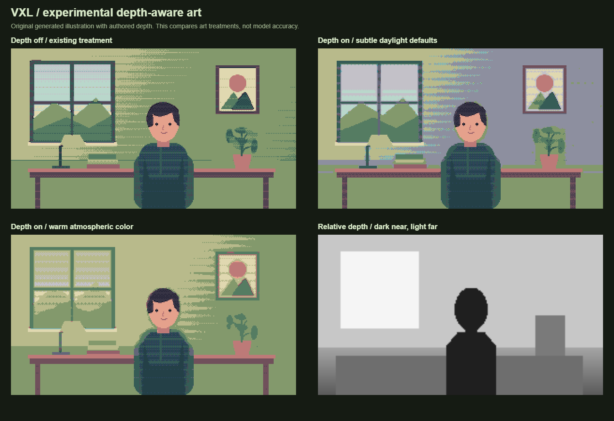

# Experimental depth-aware art

Open **Fine-tune → Experimental Settings → Depth-aware styling**. It is disabled in both built-in presets and defaults to disabled when importing older version 1 presets. Settings are saved and exported with the preset.

This experiment estimates a continuous relative distance field across an image, then uses it to guide color, texture, clusters, and outlines. It can treat objects and surfaces at different distances without assigning semantic names to them. It does not measure meters, identify individual objects, or maintain persistent object tracks.



The comparison uses VXL's original illustration and an **authored demonstration depth field**, not model predictions. Reproduce it with `pnpm compare:depth docs/depth-comparison.png`. No reference artist's images or palettes are bundled into VXL.

## Research: what artists actually do

These are findings from artists' published explanations and process examples. The implementation below is our experimental translation of those findings, not an assertion that an automatic filter reproduces their artistic judgment.

### Landscape planes and atmosphere

Raymond Schlitter's [Landscape Backgrounds](https://www.slynyrd.com/blog/2026/5/27/pixelblog-62-landscape-backgrounds) presents three useful cases:

| Pixel artwork | Artist's described treatment | Implication for VXL |
| --- | --- | --- |
| Valley battle background | Receding ground shifts toward the sky; distant mountains share sky colors. Grass marks diminish until individual blades disappear. | Reduce fine texture and color separation; preserve one pixel grid. |
| Desert battle background | Orange sand progresses through pale yellow and distant blue; red shadows move toward violet. | Use a configurable atmospheric destination instead of merely adding white. |
| Forest battle background | The scene looks from shaded foliage toward warm illumination. Distant branches remain legible because the implied distances are shorter. | Warm recession is valid, and small interiors need gentler detail loss. |

These examples distinguish **smaller depicted features** from **broader areas of simplified color**. A distant tree is smaller, while its foliage may become one readable mass. Increasing the size of every displayed pixel is not equivalent. Schlitter also discusses muting scenery to preserve interactive-element readability: visual priority can override literal distance.

### Cluster design and selective detail

Pedro Medeiros defines clusters as connected same-color pixels in [Cluster Sketching and Painting](https://saint11.art/pixel_art_articles/article2/). His example builds sky and mountains, architecture, and a foreground figure from large shapes before refinement. He discourages accidental isolated pixels while preserving intentional small accents such as eyes. This suggests removing weak scattered texture before destroying silhouettes. VXL therefore favors neighboring palette colors in low-contrast regions, respects estimated depth breaks, and reduces distant interior-line emphasis. It cannot distinguish an important one-pixel eye from an unimportant speck, so strong simplification remains an artistic tradeoff.

### Color is relational

Medeiros's [Basic Color Theory](https://saint11.art/pixel_art_articles/article6/) separates hue, saturation, and value; discusses restrained large color fields and small saturated accents; and demonstrates hue-shifting light and shadow on a vase. His church-photo example shows why a simple darker/lighter ramp misses temperature relationships. Our interpretation is that indiscriminate grayscale conversion would flatten material and lighting differences. VXL makes desaturation independent of atmosphere color and contrast, preserves the near range, and maps adjustments back to the selected palette. A two-color palette may have no suitable intermediate atmospheric color; the effect can consequently be weak or jump between available colors.

James Gurney's [Into the Golden Realm](https://gurneyjourney.blogspot.com/2023/06/into-golden-realm.html) explicitly explores warmer colors at greater distance. His [Atmospheric distance and value](https://gurneyjourney.blogspot.com/2013/07/atmospheric-distance-and-value.html) questions a simple linear distance-to-value rule and considers repeated veils of scattered light. These are reasons to expose an atmosphere color and adjustable falloff rather than hard-code a universal blue/white distance rule. The VXL controls are compositional approximations, not a physical light-scattering simulation.

### Abstraction is a choice, not a blur radius

Schlitter's [Golden Romance](https://www.slynyrd.com/blog/2024/11/1/pixelblog-golden-romance) describes choosing a 320×180 canvas to balance cloud and foliage texture with visible clusters. He emphasizes interpreting a reference's essential qualities rather than mechanically preserving every detail. This supports controlling detail density separately from output resolution. Our implementation keeps the logical grid stable and increases depth-aware filtering and color grouping. It does not invent intentional shapes, composition, or selective exaggeration in the way a human artist can.

Schlitter's [Parallax Scrolling](https://www.slynyrd.com/blog/2019/11/12/pixelblog-23-parallax-scrolling) describes slower distant layers and whole-pixel motion, while stressing that the static image should already convey depth. VXL uses depth for static readability and does not introduce artificial parallax: moving layers in ordinary footage would expose missing image content and require a different reconstruction pipeline.

## Artistic decisions in this implementation

| Signal | Current treatment | Reason and practical limit |
| --- | --- | --- |
| Relative distance | A continuous 0–1 field; optional labels at thirds | Continuous styling avoids snapping at arbitrary plane boundaries. Labels are diagnostic, not object identities. |
| Protected near range | `smoothstep(focus, 1, distance)` controls recession | Keep the closest surfaces readable; this does not select a semantic focal subject. |
| Atmosphere | Blend source colors toward a configurable airlight color | Default blue-gray is restrained; warm haze and dark mist are possible. |
| Saturation | Gradually mix toward luminance with depth | Reduce competition from distant surfaces while retaining material hues. |
| Contrast | Gradually compress source contrast toward middle gray | Weaken small value differences before palette mapping. This is a style control, not exposure compensation. |
| Detail | Expand a bilateral sample footprint and favor dominant palette neighbors | Form broader color masses without enlarging the pixel grid. Sampling rejects depth discontinuities. |
| Texture and dithering | Reduce mark strength; clean distant clusters again after patterns | Prevent texture from undoing simplification. This extra cleanup skips the protected near range. |
| Lines | Tint/reduce distant interior outlines more than silhouettes | Support shape recognition while weakening distant visual emphasis. |
| Palette | Quantize adjusted colors and outline colors back into each region's palette | Preserve palette discipline; coarse palettes limit subtle changes. Diagnostic maps intentionally use their own colors. |

Defaults: atmosphere `#b9cbd5`, atmosphere blend 12%, desaturation 14%, contrast reduction 10%, distant simplification 45%, protected near range 20%. Raise one control at a time. A haze color close to the scene's illumination usually produces a more coherent result than a strong unrelated tint. The model does not infer weather, light direction, emotional intent, or whether a far subject deserves attention.

The depth-map preview is dark near / light far. The plane preview uses teal for foreground, gold for middle ground, and blue for background. **Previews also appear in snapshots and recordings**; choose Styled art before exporting final footage.

## Estimator and lifecycle

- `src/core/types.ts` carries a `DepthField` alongside the existing optional person mask. Depth is independent of the person/background palette selection; people are not automatically declared nearest.
- `src/vision/depth.worker.ts` uses [Depth Anything V2 Small](https://github.com/DepthAnything/Depth-Anything-V2) through its [Transformers.js ONNX conversion](https://huggingface.co/onnx-community/depth-anything-v2-small), pinned to revision `4472b7362082ad9968fee890ca0f1e5aca36b93d`. The Small weights are Apache-2.0. This is the relative-depth checkpoint, not a metric checkpoint.
- Transformers.js is pinned to 3.8.1. The worker uses quantized q8 WASM inference with one thread so WebGPU is not required. The adjustable image-processor size follows the [upstream browser video example](https://raw.githubusercontent.com/huggingface/transformers.js-examples/main/depth-estimation-video/main.js); VXL uses 280-pixel processor dimensions, multiples of the model's 14-pixel patch size. Aspect-preserving preprocessing can produce a non-square output field.
- Depth workers are created only after the feature is enabled on camera/video input. The first use downloads roughly 30 MB of model data from Hugging Face; the browser runtime is served by the local build. Browser caching can reduce later downloads. Frames remain local. Native Node inference/image dependency build scripts are disabled because this feature runs in the browser.
- Loading and estimation do not block capture or the render loop. There is one in-flight copied snapshot, no backlog, and a 250 ms minimum request interval. This is an upper limit of four requests/second, not a promised inference rate.
- Predicted inverse depth is normalized using its 2nd/98th percentiles, then inverted into near-zero/far-one distance. Nonfinite and near-flat predictions are rejected. The normalization is scene-relative, so adding a much nearer object can change the scale of other depths.
- `DepthHistory` blends each successful map into the displayed field over 300 ms, including larger changes within the same scene. The effect also fades in over 300 ms. Routine depth updates preserve renderer history. Paused matching frames continue repainting until the blend completes. This is presentation smoothing, not optical-flow tracking or a video-depth model. The separate [Video Depth Anything](https://github.com/DepthAnything/Video-Depth-Anything) project targets temporal consistency; substituting it would require a separate runtime/performance investigation.
- Live estimates retain their original capture timestamps and carry an adaptive reuse budget. The hold duration is `clamp(3 × (observed latency + 250 ms), 3,000 ms, 11,000 ms)`, followed by a 1,000 ms fade. Observed latency includes bitmap preparation and worker turnaround. The renderer independently checks generation and this bounded age budget; raw/authored fields without a reuse budget retain the original 1,000 ms limit. A delayed or isolated flat prediction no longer removes an otherwise useful map.
- Cut detection compares adjacent thumbnails with a 0.22 mean-RGB-difference threshold, rather than comparing every frame to an increasingly old snapshot at 0.10. Ordinary movement or gradual exposure changes therefore do not repeatedly switch the effect off. Clear cuts and seeks still invalidate cached maps and outstanding results; source changes and disabling the effect terminate the worker.
- If estimates stop arriving, strength fades smoothly before the field expires, at most 12 seconds after capture. Worker errors also fade the displayed effect over one second and expose Retry. Status messages distinguish retained estimates from waiting for an initial/fresh map. A matching paused frame can still receive and animate its estimate without resuming playback.

## Remaining experimental limits

This is per-pixel relative depth, not object segmentation. Glass, mirrors, thin structures, unseen geometry, occlusion, and unusual camera views can confuse the estimator. Depth errors can lead to inappropriate color treatment. A low-resolution field can soften boundaries. Retaining and blending sparse estimates improves visual continuity but can lag behind fast local motion: maps are not motion-reprojected. Scene-cut detection uses an average-image comparison and cannot detect every cut or distinguish every lighting flash. Long stalls still fade the effect out after the bounded reuse window; paused-frame experiments remain useful on slower machines.

Atmospheric depth is also not a universal camera correction. Ordinary indoor distances may need almost no haze, and footage may already contain strong atmospheric cues. A distant focal subject may deserve more detail, not less. Manual focal masks, atmosphere estimation, tracked depth reprojection, and quality/performance presets are possible later experiments, not implemented features.

## Verification

See [VALIDATION.md](VALIDATION.md) for checks run on this revision. Automated analytic fixtures verify rendering behavior independently of model quality. The opt-in model checks exercise actual model loading/inference and synthetic-camera integration; they do not establish real-world depth accuracy, metric distance, hardware FPS, or artistic quality across arbitrary footage.

```powershell
pnpm build
pnpm test
pnpm test:e2e
$env:VXL_TEST_DEPTH_MODEL = '1'
pnpm test:e2e tests/browser/depth.spec.ts
# To exercise the compiled production worker as well:
$env:VXL_TEST_PREVIEW = '1'
pnpm test:e2e tests/browser/depth.spec.ts
```
