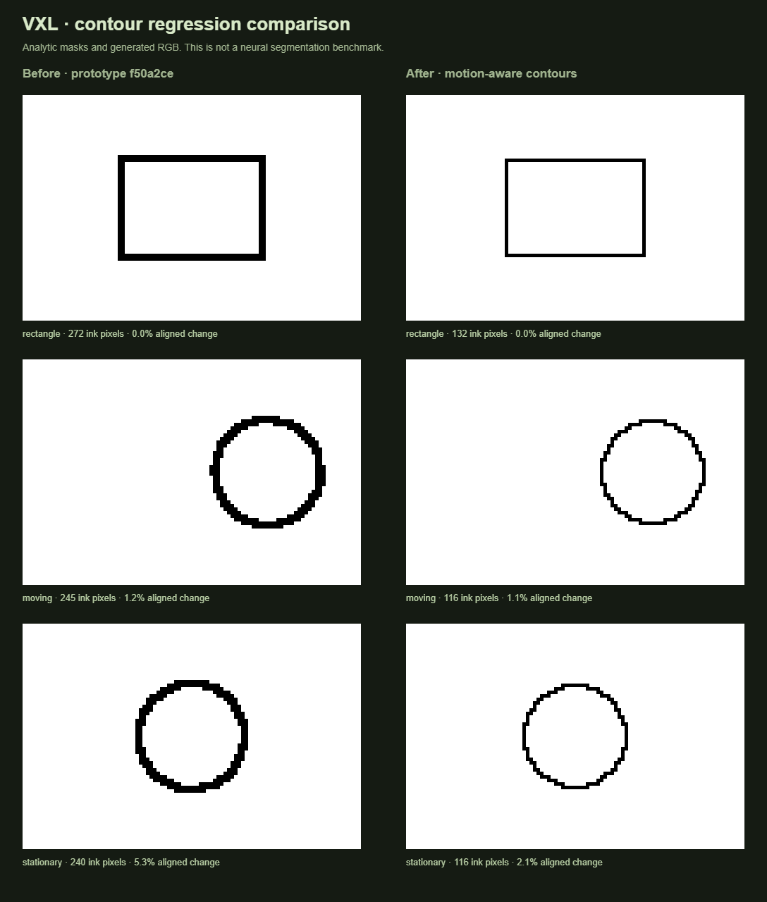

# Stable pixel contours

The original renderer drew a boundary on both the person and background, used the largest nearby RGB difference as an interior edge, and reused history at fixed screen coordinates. This made nominal one-pixel borders too thick, spread interior edges into bands, and allowed motion to borrow unrelated pixels from the old frame. Selective outlining also switched abruptly based on quantized colors.

## Current approach

1. Prepare a lightly filtered source and a spatially smoothed confidence mask on the shared logical pixel grid.
2. Estimate backward motion on a quarter-resolution grid with a small coarse-to-fine RGB/mask block search. Stationary blocks skip the search. Poor matches discard history.
3. Warp previous evidence into the current frame. Apply confidence-aware mask blending and hysteresis to uncertain boundaries; confident new labels take precedence. Confidence is blended from unshifted evidence so classification bias cannot accumulate into a trail.
4. Build a Euclidean-distance silhouette band on one side only. The person owns it when its outline is enabled; otherwise an enabled background outline owns the outside band. Enabling both never doubles thickness.
5. Detect interior edges from the unpatterned source with controllable derivatives, directional nonmaximum suppression, and strong/weak thresholds. Two-pixel lines grow along a single normal rather than spreading on both sides.
6. Stabilize selective-outline strength only when a matching old boundary exists. An old object's interior cannot suppress a newly exposed edge. No outline survives outside the current band/edge support.
7. Composite palette-constrained strokes. Colored lines choose a perceptually darker palette entry; a sparse palette no longer silently maps a white object's outline back to white. Dithering and textures do not determine contour geometry.

Palette Oklab coordinates are cached on the CPU instead of recalculated for every candidate color in every fragment. This offsets some of the new GPU work without changing the color transform or adding a runtime dependency.

## Controls and compatibility

- **Contour smoothing:** spatial confidence smoothing and the width of the interior-edge derivative. Higher settings suppress small boundary and texture variations.
- **Outline stability:** motion-aligned confidence and selective-line history. Lower it for a more immediate response to rapidly changing shapes.
- **Temporal stability:** remains the separate color-stability control.
- **Thickness:** one or two logical pixels, with a single silhouette owner.

Version 1 presets and saved sessions remain compatible. Missing `outlineStability` and `contourSmoothing` fields receive defaults of 0.65 and 0.55. The bundled Sprite Scene preset uses slightly stronger contour stabilization. Source changes, scene cuts, resolution changes, explicit resets, and long frame gaps invalidate history.

## Comparison and tests



[Raw fixture measurements](outline-comparison.json) compare the renderer in commit `f50a2ce` with this implementation. Both use the same generated white RGB frames and confidence masks, the Pixel Video color-stability setting, and a black/white palette. New outline stability is 0.8 and smoothing is 0.55. The moving circle advances two logical pixels per frame while boundary confidence receives deterministic noise.

`temporalChange` is the symmetric difference of consecutive ink-pixel sets divided by their combined size, after compensating for the fixture's known translation. It is a contour-change diagnostic, not a semantic-segmentation score. Line thickness differs between implementations, so read the normalized change together with band ownership and ink counts. Pixel quantization during real movement is expected.

Reproduce the optional comparison after installing the project-local Chromium browser:

```sh
node scripts/compare-outlines.mjs
```

It writes PNG/JSON results into `.cache/` and reads the original renderer from Git history. It requires that the initial prototype commit be present. To update these documentation artifacts deliberately, pass `docs/outline-comparison.png` as its argument. No external video or person image is used.

The regression suite also checks exact one/two-pixel widths, background ownership, noisy motion, disappearance, a jump beyond the motion-search range, low-rate frames, selective lines, interior-line thinning, sparse palettes, frozen redraws, and history resets. These isolate renderer behavior from model accuracy. Physical webcams, complex occlusions, and ordinary-laptop performance still require direct evaluation.

## Research references

- [SAM 2](https://github.com/facebookresearch/sam2) uses streaming memory for promptable video segmentation. It informed the distinction between carrying relevant temporal state and treating frames independently. VXL does not run SAM 2 or copy its neural architecture; its current person model remains unchanged.
- [Temporally stable video segmentation without video annotations](https://arxiv.org/abs/2110.08893) describes optical-flow consistency and temporal filtering. VXL uses its own small block-matching and confidence-gating implementation, not that paper's trained decoder or filter implementation.
- [David Holland's pixel-art rendering discussion](https://www.davidhol.land/articles/3d-pixel-art-rendering/) describes procedural outlines and the temporal artifacts that remain at low pixel resolutions. Its 3D depth/normal buffers are not available from an ordinary webcam.

Motion search has a limited radius and does not establish persistent object identity. Newly confident masks still determine the current silhouette; this work cannot repair a confidently incorrect person prediction or provide SAM 2's prompted object tracking.
